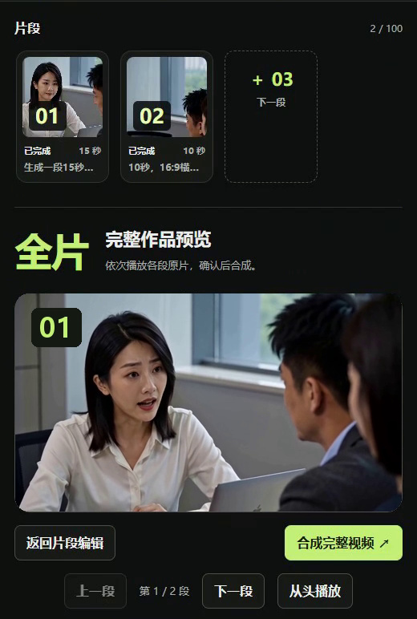
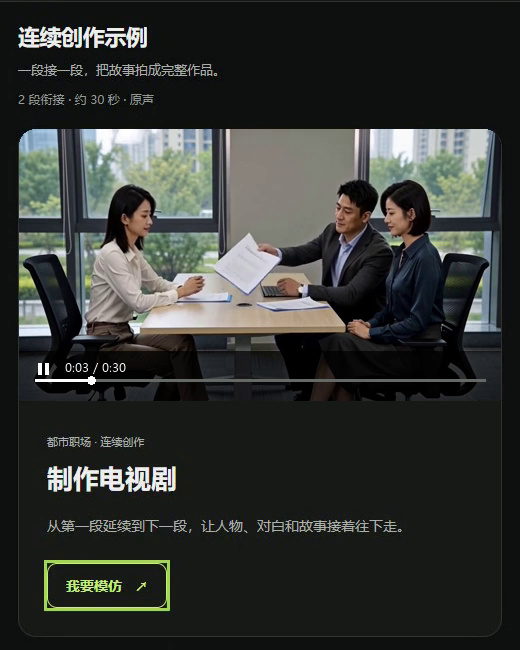
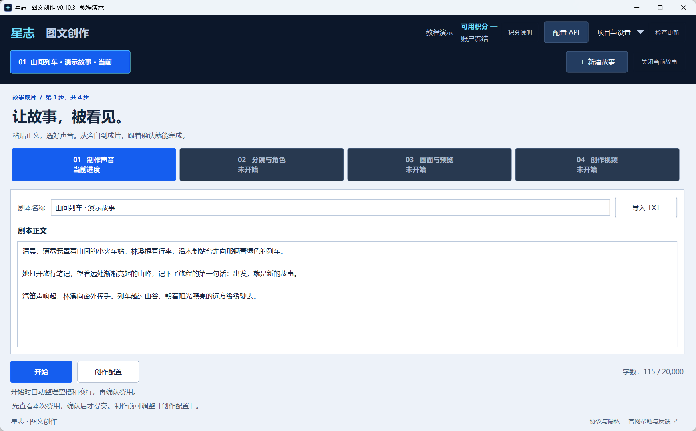
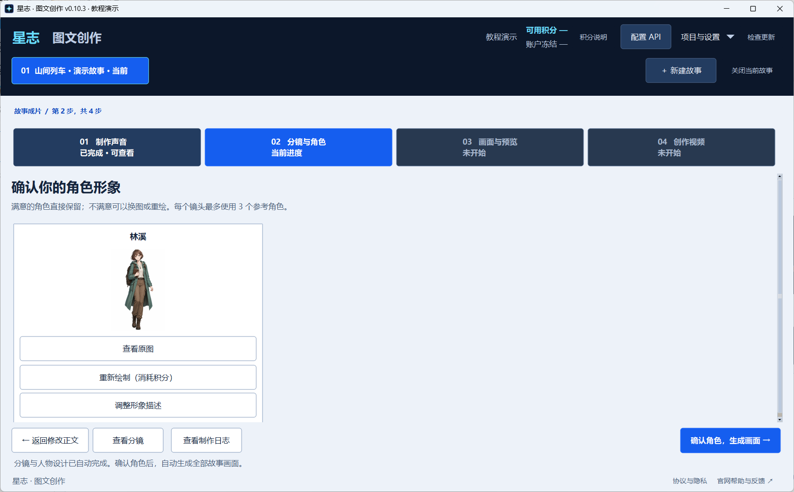
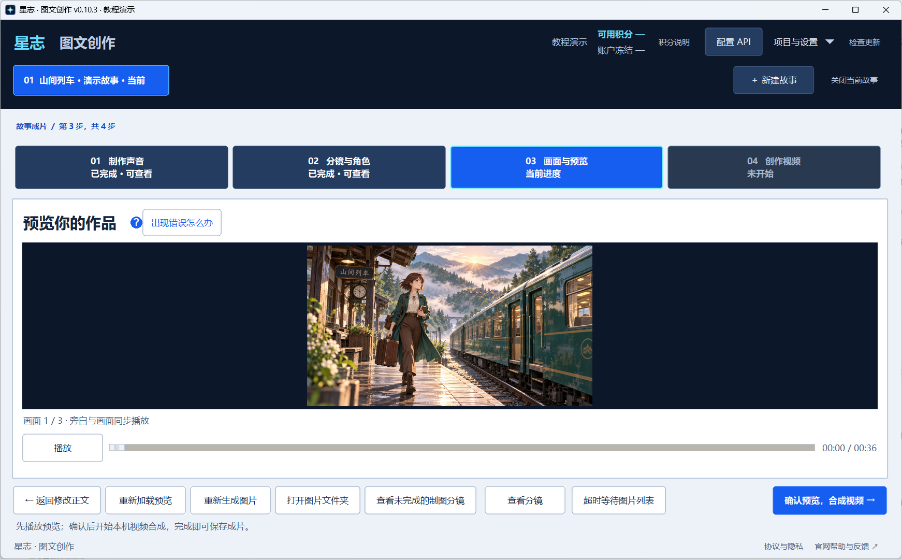

# 星志｜MiniMax H3 AI 视频、AI 配音与图文视频制作

星志（XZAnime）面向 AI 短剧、AI 漫剧、故事解说和短视频创作者，提供 **MiniMax H3 AI 视频生成**、尾帧续拍、连续创作、整片合成，以及 **AI 语音与配音**、图文视频制作。支持网页、Windows 桌面工具和开发者 API。

如果你在寻找低成本 AI 视频工具，可以先按模型、时长、质量和调用渠道比较费用，再选择文字生成视频、图片参考生成视频，或将故事正文制作成带旁白的图文视频。星志是独立创作服务，本仓库为产品与接入资料，不是 MiniMax 官方仓库，也不提供模型权重。

**[官方网站](https://xzanime.com/) · [实时价格与预算选择](https://xzanime.com/pricing#quick-price) · [MiniMax H3 AI 视频](https://xzanime.com/ai-video) · [AI 配音](https://xzanime.com/ai-dubbing) · [图文视频制作](https://xzanime.com/story-video)**

> **一段 10 秒 AI 视频多少钱？** 2026 年 10 月 22 日核对：MiniMax H3 快速档、768p，网页 4 折活动期间 **10 秒整段 80 积分，约 0.80 元**；API / 桌面工具同规格 **10 秒整段 200 积分，约 2.00 元**。均为基础生成费，不含参考视频、2K 高清化等附加费用。人民币按 100 积分约合 1 元测算，不含充值赠送；最低充值 10 元。网页活动截至 **2026 年 10 月 31 日 14:05:44（北京时间）**。详见下方[价格与费用示例](#价格与费用示例)，最新报价以官网为准。


站内 AI 视频示例画面，剧情虚构。

## MiniMax H3 AI 视频生成

使用 MiniMax H3，从文字描述或参考素材开始制作视频，适合剧情片段、人物演绎、动画短片和创意镜头。当前公开报价提供 **4–15 秒、768p** 的基础生成选项；网页和 API 的档位、活动分别展示在[价格页](https://xzanime.com/pricing)。

- **文字生成视频**：描述人物、场景、动作、镜头和声音要求，提交生成视频。
- **图片与视频参考**：上传参考图片或视频，结合提示词说明希望保留的人物外观、场景、画风或运镜。
- **横屏与竖屏**：支持横屏和竖屏创作，可按内容选择画幅与生成时长。
- **多档质量选择**：提供快速、标准、增强和高质量档位，按创作需要选择。
- **2K 高清化**：可在生成时选择，也可以在原片完成后单独处理；高清化保留原声音，原片仍可查看和下载。

## 连续创作与整片合成

把一段段视频接成连续作品，逐段推进剧情，并在合成前检查每一段的效果。

- **尾帧续拍**：使用上一段视频的最后一帧作为下一段参考，结合新剧情继续生成。
- **已有视频创作续集**：已完成的单段视频可以作为连续作品的第一段，直接开始后续创作。
- **分段预览与重做**：查看各段视频，对需要调整的片段单独重做。
- **整片合成**：按作品中的片段顺序合成完整视频，完成后下载成片。

例如，先生成角色走进房间的镜头，再引用尾帧继续拍摄对话，随后接上角色离开的片段，逐段完成一个短剧场景。

| 引用上一段尾帧 | 预览片段并合成完整视频 |
| --- | --- |
|  |  |

## 示例模板与中文提示词助手

从已有示例入手，了解参考素材、镜头描述和剧情安排如何配合使用。

- **示例模仿**：查看站内示例，点击「我要模仿」，带入对应提示词和参考素材，再修改成自己的内容。
- **提示词助手**：根据你的文字需求整理视频提示词，生成后可以继续编辑，再提交视频任务。
- **中文写作指南**：提供人物、动作、镜头、对白、环境声音和背景配乐的写法说明，以及可复制的示例。



## AI 语音与配音：Azure、Qwen3、豆包 TTS 2

通过文字生成旁白与配音，可用于小说解说、故事视频和短视频。当前公开价格列出的语音服务包括 **Azure、Qwen3、豆包 TTS 2**；音色与可选参数以创作页面为准。

2026 年 10 月 22 日核对，以下为 **每 1,000 字符**的生成费用，不是每分钟或每条视频价格：

| 语音服务 | 网页：1,000 字符 | API：1,000 字符 |
| --- | --- | --- |
| Azure | 25 积分，约 0.25 元 | 25 积分，约 0.25 元 |
| Qwen3 | 25 积分，约 0.25 元 | 25 积分，约 0.25 元 |
| 豆包 TTS 2 | 50 积分，约 0.50 元 | 50 积分，约 0.50 元 |

人民币按 100 积分约合 1 元测算，不含充值赠送。网页视频的 4 折活动不适用于以上配音报价；实际字符计数与费用以提交前报价为准。[查看 AI 配音介绍](https://xzanime.com/ai-dubbing) · [查看实时价格](https://xzanime.com/pricing)

## 图文故事成片

Windows「星志 · 图文创作」适合将已有故事、小说片段或解说文案制作成带旁白的图文视频。

1. **制作旁白**：粘贴故事正文，选择音色生成声音，试听并确认。
2. **设计分镜与角色**：自动拆分故事画面，生成分镜设计、角色描述和角色参考图；可以调整描述或重绘角色。
3. **生成画面与预览**：根据分镜和角色参考生成图片，在本机完成音画匹配，预览画面与旁白的衔接。
4. **合成视频**：确认预览后，在本机合成并导出视频。

未完成的画面可以单独查看、修改提示词、重绘或补全；已有素材和制作进度会随故事保存，重新打开软件后可以继续处理。

本机音画匹配和视频合成使用 CPU，无需独立显卡。旁白、文字设计和绘图使用联网 AI 服务，生成后的素材与成片保存在本地故事目录中。

以下为桌面工具教程演示界面，使用示意故事和插画展示操作流程。

| 输入故事正文并选择声音 | 确认角色形象与参考图 |
| --- | --- |
|  |  |



## 网页与 Windows 桌面工具

网页 AI 视频支持电脑和手机访问，无需自行部署模型。登录后可以查看生成任务、历史视频和连续作品，并进行预览、续作和下载。

Windows 桌面端提供两个独立工具：

| 工具 | 主要用途 |
| --- | --- |
| 星志 · 图文创作 | 故事正文、旁白、分镜、角色与画面生成，本机预览和视频合成 |
| 星志 · AI 视频 | 单段视频生成、参考素材上传、尾帧续拍、连续作品和视频库管理 |

桌面工具适用于 Windows 10 / 11 x64，内置所需运行环境，通过官网申请的 API Key 连接星志服务。

## 开发者 API

开发者可以通过 API 将 AI 视频能力接入自己的应用、脚本或创作流程。

- 提交视频生成任务，配置提示词、时长、画幅和质量档位。
- 上传参考图片与视频，并查询任务状态和获取生成结果。
- 管理连续作品，获取尾帧参考，提交整片合成并下载成片。
- 读取同账号的视频作品，在网站查看调用日志和积分使用情况。

接入说明与 API Key 管理入口位于官网的「开发者」栏目。

### 无需登录的实时查价示例

[公开价格接口](https://xzanime.com/api/public/pricing)返回视频模型、分辨率、时长、网页 / API 报价、活动期限、配音价格与计费条件。以下 Python 3 示例只查询价格，不创建生成任务、不需要 API Key，也不消耗创作积分。先安装请求库：

```bash
python -m pip install requests
```

```python
from decimal import Decimal
import requests

response = requests.get(
    "https://xzanime.com/api/public/pricing",
    headers={"Accept": "application/json"},
    timeout=20,
)
response.raise_for_status()
pricing = response.json()
if not pricing.get("available"):
    raise RuntimeError("报价暂不可用，请访问 https://xzanime.com/pricing")

rate = Decimal(str(pricing["points_per_yuan_for_estimate"]))
duration = "10"
for channel, label in (("web", "网页"), ("api", "API / 桌面工具")):
    video = pricing["video"][channel]
    print(f"{label} | {video['model']} | {video['resolution']} | 每段 {duration} 秒")
    for tier in video["tiers"]:
        points = tier["examples"][duration]["points"]
        yuan = Decimal(str(points)) / rate
        print(f"  {tier['label']}：{points} 积分 / 段，约 CNY {yuan:.2f} / 段")
    promotion = video["promotion"]
    if promotion["active"]:
        print("  活动价比例：", promotion["percent"], "%")
        print("  活动结束时间（ISO 8601）：", promotion["ends_at"])

print("计费条件：")
for condition in pricing["conditions"]:
    print("-", condition)
print("最低充值金额：CNY", pricing["minimum_recharge_yuan"])
print("实时价格页：", pricing["canonical_url"])
```

这个接口用于查询公开价格；视频生成接口需要登录官网，在「开发者」中申请 API Key 并按接入文档调用。请使用接口返回的当前价格、活动状态和计费条件，不要把本页带日期的示例当作永久报价。

## 适合的创作场景

- **AI 短剧与漫剧**：使用角色参考和尾帧续拍，分段制作剧情视频。
- **小说与故事解说**：将已有正文转换为旁白、分镜图片和图文成片。
- **短视频与创意演示**：从文字或参考素材出发，制作独立镜头与短片。
- **开发者应用接入**：在自有工具中调用视频生成与连续创作能力。

## 价格与费用示例

云端创作按积分计费。以下人民币金额统一按 **100 积分折合 1 元** 测算，**不计充值赠送**，用于比较创作费用；实际人民币成本取决于所选充值套餐。

### MiniMax H3：生成一段 10 秒视频多少钱？

价格核对日期：**2026 年 10 月 22 日**。统一比较 **MiniMax H3、768p、10 秒整段、无参考视频、不选高清化**。表格金额均为**每段 10 秒的总生成费**：

| 质量档位 | 网页：10 秒整段（4 折活动） | API / 桌面工具：10 秒整段 |
| --- | --- | --- |
| 快速 | **80 积分，约 0.80 元 / 段** | 200 积分，约 2.00 元 / 段 |
| 标准 | **120 积分，约 1.20 元 / 段** | 300 积分，约 3.00 元 / 段 |
| 增强 | **180 积分，约 1.80 元 / 段** | 450 积分，约 4.50 元 / 段 |
| 高质量 | **240 积分，约 2.40 元 / 段** | 600 积分，约 6.00 元 / 段 |

- **活动期限**：本次核对时，官网显示网页 AI 视频 **4 折**活动截至 **2026 年 10 月 31 日 14:05:44（北京时间）**。到期后请以官网当时的活动状态和报价为准；上表活动价不能直接用于到期后的订单。
- **适用范围**：表中仅计算基础视频生成费，未计参考视频附加费、可选 2K 高清化、独立提示词处理及重新生成的费用；具体项目以提交前报价为准。
- **调用渠道**：此优惠为网页活动，开发者 API 不参加；通过 API 连接的桌面工具按对应 API 报价计费。
- **充值与生成费**：最低充值金额为 **10 元**。每段生成费与最低付款金额是不同概念；充值后按实际任务消耗积分。

来源：[官网实时价格页](https://xzanime.com/pricing) · [公开价格 JSON](https://xzanime.com/api/public/pricing)。本 README 是上述核对日期的价格快照，不会自动随官网变动；最终费用以官网提交前显示的报价为准。

### 低价 AI 视频：1 元、2 元、5 元预算能生成什么？

以下预算均指**生成一段 10 秒视频的费用上限**，采用上表同一规格与活动条件，不代表最低充值金额：

| 每段预算上限 | 网页可选档位（4 折活动） | API / 桌面工具可选档位 |
| --- | --- | --- |
| 1 元 / 10 秒整段 | 快速，约 0.80 元 | 当前无符合该预算的档位 |
| 2 元 / 10 秒整段 | 快速 0.80 元、标准 1.20 元、增强 1.80 元 | 快速，约 2.00 元 |
| 5 元 / 10 秒整段 | 快速 0.80 元、标准 1.20 元、增强 1.80 元、高质量 2.40 元 | 快速 2.00 元、标准 3.00 元、增强 4.50 元 |

比较其他 AI 视频服务时，建议同时核对模型、时长、分辨率、参考素材附加费、活动有效期和最低充值额，避免只比较没有单位的起步价。[按预算查看官网当前选项](https://xzanime.com/pricing#budget)

### 图文故事成片：一次实际制作的费用

2026 年 10 月 20 日制作的「雨夜怪谈」：**9,901 字、128 个分镜，成片约 29 分 09 秒，最终净消耗 1,540 积分，按上述口径折合 15.40 元**。

| 制作项目 | 本次净消耗 |
| --- | --- |
| 故事旁白 | 248 积分 |
| 故事背景分析与角色文字设计 | 56 积分 |
| 分镜设计 | 384 积分 |
| 角色图与分镜图，含成功重绘 | 840 积分 |
| AI 提示词优化 | 12 积分 |
| 本机文本切割、音画匹配与视频合成 | 0 平台积分 |
| **合计** | **1,540 积分，约 15.40 元** |

这是带旁白的图文视频制作案例，费用已计入本次成功重绘与提示词优化，并扣除失败出图已退回的积分；不含电费、硬件、人工及教程制作费用。它不代表同等时长动态 AI 视频的生成价格，也不是每个故事的固定报价。实际消耗会随字数、模型、分镜数量及重做次数变化。

## 开始使用

访问 [星志官网](https://xzanime.com/)，先查看示例作品，再选择网页 AI 视频或下载桌面创作工具。网页创作需登录；桌面工具首次使用需配置官网 API Key。

云端 AI 创作按积分计费，具体费用以提交前显示的报价为准。本地图文工具的音画匹配、预览和视频合成不消耗网站积分。

## 常见问题

**MiniMax H3 可以直接在线使用吗？需要本地显卡吗？** 通过[网页 AI 视频](https://xzanime.com/ai-video)入口登录后可以创作，云端视频生成无需自行部署模型或准备本地显卡。Windows 图文工具的本机音画匹配与合成使用 CPU，旁白和绘图仍调用联网服务。

**10 秒约 0.80 元，是每秒 0.80 元吗？** 这里指活动期间网页快速档 **10 秒整段**的基础生成费，条件是 MiniMax H3、768p、无参考视频、不选高清化。API 和桌面工具同规格约 2.00 元 / 10 秒整段。优惠有期限，最新数值见[实时价格页](https://xzanime.com/pricing#quick-price)。

**AI 配音和图文视频是否都按视频秒数收费？** 配音按对应服务的字符计费规则报价；图文故事涉及旁白、文字设计、绘图等项目。上面的长片历史案例的单次总成本，不能套用为动态 AI 视频的每秒单价。

**如何获取最新价格或接入 API？** 无需登录即可访问[价格页](https://xzanime.com/pricing)和[公开价格 JSON](https://xzanime.com/api/public/pricing)；生成接口的文档、API Key 和调用记录在官网「开发者」栏目。本仓库的示例只读取公开报价。

## English overview

XZAnime is an independent AI video generator and Chinese text-to-speech service with web, Windows and developer API workflows. It supports MiniMax H3 text-to-video and image-reference video generation, tail-frame continuation, short-drama creation and narrated story videos. Speech options include Azure, Qwen3 and Doubao TTS 2.

For low-cost AI video generation, compare the same model, resolution, duration and channel. The [live pricing page](https://xzanime.com/pricing) and [public pricing API](https://xzanime.com/api/public/pricing) show prices in CNY, points, promotion expiry and additional-fee conditions. Website promotions and API prices are separate. This repository contains product documentation, not MiniMax model weights or an official MiniMax implementation.
